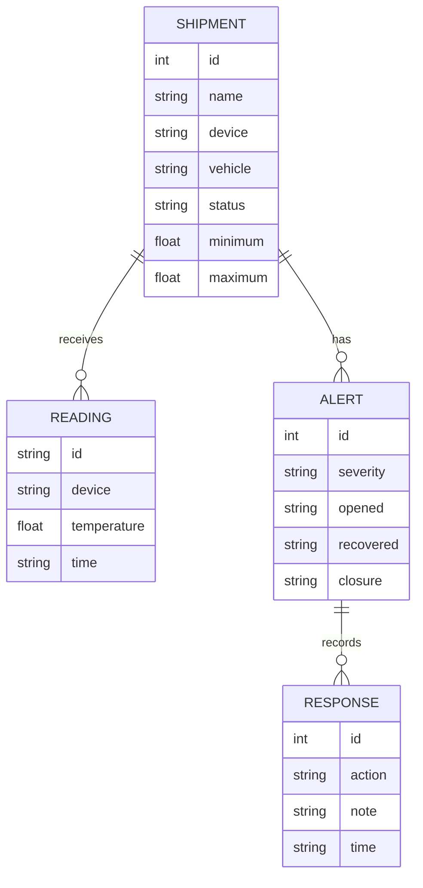
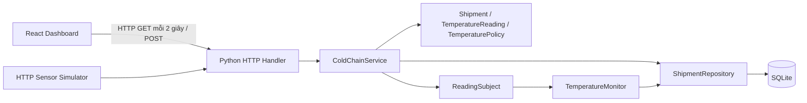

# Báo cáo dự án G2 — Quản lý và điều phối chuỗi lạnh bằng IoT

## 1. Bài toán và phạm vi

Đề yêu cầu một nền tảng phần mềm theo dõi hàng nhạy cảm với nhiệt độ trong quá trình giao nhận, ứng dụng Domain-Driven Design, Observer Pattern và Repository Pattern. Dữ liệu cảm biến được phép mô phỏng để không phụ thuộc phần cứng.

Bản triển khai cung cấp một quy trình hoàn chỉnh: tạo chuyến → phân xe → tiếp nhận số đo → phát hiện bất thường → ghi nhận phản ứng của người điều phối → xác nhận phục hồi bằng số đo mới → hoàn tất giao hàng. Sản phẩm mẫu là hàng lạnh giả định với khoảng an toàn 2–8°C.

Phạm vi là ứng dụng chạy cục bộ cho một nhóm điều phối. Không bao gồm tài khoản, phân quyền, bản đồ GPS, tối ưu tuyến, tính cước, SMS/email, tiêu chuẩn bảo quản dược phẩm hay phần cứng đã triển khai thực tế.

## 2. Yêu cầu chức năng

| ID | Yêu cầu | Điều kiện nghiệm thu |
|---|---|---|
| FR01 | Tạo chuyến với tên, sensor, khoảng nhiệt độ | Tên/sensor không rỗng; min < max; trả mã chuyến |
| FR02 | Điều phối chuyến | Có mã xe; chỉ planned → in_transit → delivered |
| FR03 | Nhận số đo IoT | Có readingId, shipmentId, deviceId, temperature, time và unit C |
| FR04 | Phân loại nhiệt độ | Chính xác ở cả ngưỡng thấp và cao, bao gồm các điểm biên |
| FR05 | Cảnh báo và xử lý | Có severity, thời gian, hành động và ghi chú; xử lý không đổi nhiệt độ |
| FR06 | Lưu trữ | Chuyến, số đo, cảnh báo và phản ứng còn sau khi mở lại DB |
| FR07 | Dữ liệu lỗi | Từ chối sensor sai, NaN, tương lai, sai thứ tự và ID xung đột |
| FR08 | Dashboard | Danh sách, chi tiết, thống kê, trạng thái tải/lỗi/trống/mất tín hiệu |
| FR09 | Mô phỏng | Chuỗi 5 → 9 → 12 → 5 chạy qua HTTP không cần ESP32 |

Yêu cầu phi chức năng trong phạm vi demo: backend không cần thư viện ngoài; quy tắc có unit test; frontend build được; thao tác có phản hồi lỗi; dữ liệu ghi trong transaction để tránh lưu số đo mà thiếu cảnh báo.

## 3. Ngôn ngữ nghiệp vụ và mô hình miền

| Thuật ngữ | Ý nghĩa |
|---|---|
| Shipment | Một chuyến/lô hàng theo dõi, có định danh và vòng đời |
| TemperatureReading | Một số đo bất biến gồm sensor, thời gian, nhiệt độ và mã chống trùng |
| TemperaturePolicy | Quy tắc phân loại nhiệt độ của sản phẩm demo |
| Alert | Một đợt cảnh báo với mức độ và thời điểm bắt đầu/kết thúc |
| DispatchResponse | Bản ghi hành động và ghi chú của người điều phối |
| Vehicle | Mã xe được nhập khi xuất phát; chưa có quản lý đội xe độc lập |

Bối cảnh nghiệp vụ của bản nhỏ này là giám sát và điều phối chuỗi lạnh. Shipment là thực thể trung tâm; TemperatureReading và TemperaturePolicy là các value object bất biến trong Python. Thực thể Shipment giữ quy tắc chuyển trạng thái. Alert và DispatchResponse hiện được lưu dưới dạng bản ghi quan hệ và trả qua read model, chưa có đầy đủ lớp entity riêng.

Đây là áp dụng DDD ở mức phù hợp bài tập: ngôn ngữ thống nhất, quy tắc miền tách khỏi HTTP/UI, thực thể có vòng đời và use case điều phối. Không tuyên bố đã xây dựng kiến trúc microservice hay đầy đủ tactical DDD; application service vẫn dùng transaction của SQLite repository trực tiếp, là điểm có thể cải tiến bằng Unit of Work/port khi mở rộng.

## 4. Quy tắc nghiệp vụ

Với khoảng demo [2,8], giá trị trong khoảng đóng là normal. Lệch ra ngoài tối đa 2°C là warning, lệch hơn 2°C là critical. Vì vậy 0 và 10°C là warning, còn 2 và 8°C là normal. API cho phép cấu hình min/max; UI tạo theo [2,8].

Số đo phải thuộc đúng sensor gắn với chuyến, có thời gian ISO 8601 kèm múi giờ, không ở tương lai và mới hơn số đo cuối. ID trùng với cùng nội dung được xử lý idempotent: không ghi thêm và không phát cảnh báo lần nữa. ID trùng khác nội dung bị từ chối. Bản demo từ chối số đo đến sai thứ tự thay vì tự sắp xếp lại lịch sử. Cần đồng bộ đồng hồ máy gửi và server.

Một đợt warning lặp lại không tạo thêm alert. Khi chuyển warning sang critical hoặc ngược lại, alert cũ đóng với trạng thái superseded và tạo alert ở mức mới. Khi trở lại normal, alert hiện tại đóng với trạng thái recovered. Cột `recovered` trong DB/API đóng vai trò thời điểm kết thúc đợt; phải đọc cùng `closure`/`status` để phân biệt phục hồi với thay đổi cấp cảnh báo.

Người điều phối ghi nhận một hành động thì alert mở chuyển sang acknowledged. Điều này không đồng nghĩa điều kiện vận chuyển đã bình thường. Nhiệt độ không bị sửa để minh họa việc xử lý thành công.

Sau 30 giây không có số đo, UI hiển thị timeout; severity vẫn giữ kết quả nhiệt độ cuối, không suy diễn nhiệt độ mới. `planned → in_transit → delivered`; bước cuối cần số đo còn mới và normal. Chuyến delivered không nhận số đo mới, nhưng retry cùng readingId đã nhận vẫn idempotent.

## 5. Kiến trúc và các pattern

- Presentation: React hiển thị và gửi lệnh; HTTP handler phân tuyến và trả JSON.
- Application: ColdChainService triển khai create, ingest, respond, dispatch.
- Domain: Shipment kiểm tra vòng đời; TemperatureReading xác thực số đo; TemperaturePolicy phân loại.
- Infrastructure: ShipmentRepository bao bọc SQL, đọc/ghi chuyến, số đo, cảnh báo và phản ứng.

**Observer:** ReadingSubject nhận subscriber TemperatureMonitor. Khi nhận số đo hợp lệ mới, service lưu số đo rồi gọi notify trong cùng transaction. Monitor tính severity và cập nhật cảnh báo qua repository. Nếu observer lỗi, transaction rollback toàn bộ. Hiện có một subscriber thực tế phía backend. Phía React có subject riêng cho feed và một listener; đó không phải bốn observer như bản giao diện cũ.

**Repository:** ShipmentRepository tập trung câu lệnh SQL. HTTP handler không viết SQL; TemperaturePolicy không biết SQLite. Thay hệ lưu trữ cần triển khai lại adapter và xử lý transaction tương ứng.

**OOP:** Các lớp có trách nhiệm rõ ràng; policy và reading dùng dataclass frozen; service dùng composition để phối hợp repository và subject. Không thêm kế thừa chỉ để đủ hình thức.

**Thời gian thực:** xử lý cảnh báo diễn ra ngay trong request nhận số đo; dashboard polling 2 giây. Đây là cập nhật gần thời gian thực, chưa phải WebSocket/SSE hoặc hệ thống có cam kết độ trễ.

## 6. Lưu trữ và giao diện

SQLite có bốn bảng shipments/readings/alerts/responses với khóa ngoại. Reading ID là khóa chính. BEGIN IMMEDIATE tuần tự hóa ingest và dispatch để kiểm tra rồi cập nhật không bị chen giữa bởi request khác. Mỗi request dùng connection riêng. Danh sách chuyến trả tối đa 60 nhiệt độ gần nhất cho giao diện; API readings trả toàn bộ lịch sử đã lưu.

Dashboard có tạo chuyến, phân xe, nhập số đo và nút kịch bản 5/9/12/-1°C, chọn chuyến xem chi tiết, ghi hành động, nhật ký và thông tin kết nối. Các trang Shipments, Alerts, Reports tiếp tục sử dụng backend. Settings hiện dùng bảng thao tác demo thay cho giả lập thay đổi connection ở bộ nhớ trình duyệt.

## 7. Kiểm thử và giới hạn

Xem `shared/testing/KET_QUA_KIEM_THU.md` để biết kiểm thử đã thực hiện. Không coi bài test là bằng chứng đã kiểm chứng phần cứng thực tế.

Giới hạn: không xác thực người điều phối nên response chưa lưu danh tính; mã xe là văn bản tự nhập, chưa kiểm tra trùng lịch xe; không có GPS; không xử lý dữ liệu đến muộn bằng event time; không có phân trang lịch sử; số lượng chuyến tăng lớn sẽ cần tối ưu truy vấn. HTTP server chỉ bind localhost cho demo. Bộ React dùng react-scripts cũ nên dependency có thông báo deprecated; chưa thực hiện kiểm toán bảo mật triển khai production.

Hướng mở rộng: cổng MQTT/ESP32, xác thực, quản lý xe và tài xế, WebSocket, Unit of Work, cơ chế phát sự kiện bền vững, PostgreSQL và hàng đợi khi cần nhiều thiết bị.

## 8. Gợi ý phân công khi báo cáo

| Vai trò | Phần nên nắm và trình bày |
|---|---|
| Lead | Bài toán, phạm vi, yêu cầu và luồng demo |
| Domain/backend | Quy tắc, entity, API, transaction và repository |
| Frontend | Các thao tác, đồng bộ backend, trạng thái lỗi và trống |
| IoT | Payload, giả lập HTTP, định danh và thời gian số đo |
| QA/documentation | Test biên, lỗi, persistence, kịch bản và hạn chế |

Đây là gợi ý phân chia trình bày theo cơ cấu thư mục, không phải xác nhận đóng góp cá nhân hoặc biên bản nhóm đã review.
